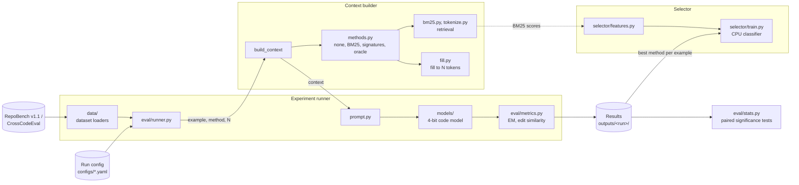
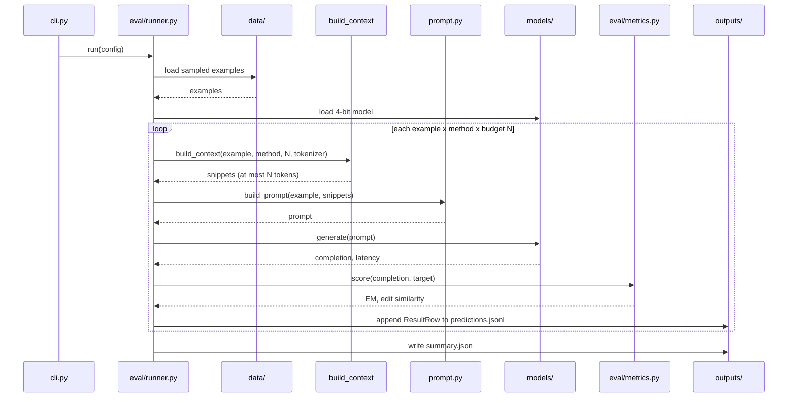
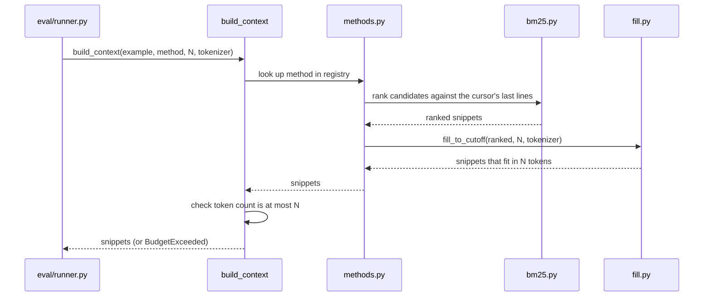
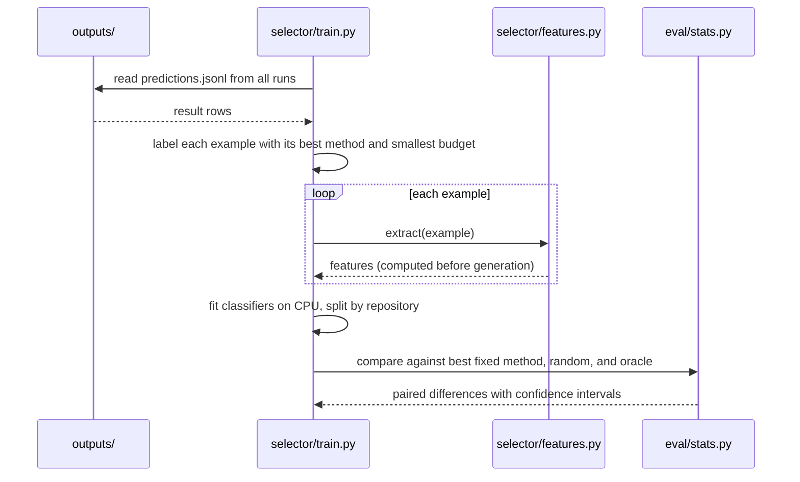

# Architecture

How the parts of `src/rac/` fit together once the project is complete.

## Components

### Reading the diagram

- **Experiment runner** loops over examples, methods, and context budgets N. Each completion is
  built from the context, generated by the model, scored, and written to `predictions.jsonl`.
- **Context builder** is the boundary between the runner and retrieval. `build_context` picks a
  method from its registry and guarantees the result fits in N tokens.
- **Selector** learns from the results which method and budget work best for each example,
  using features available before generation (including BM25 scores).
- **Stats** compares methods on the same examples to decide which differences are real.
- `types.py` (`Example`, `Snippet`, `ResultRow`) is the shared data contract used by every box.

## Sequences

### One experiment run

`python -m rac run configs/<run>.yaml` produces one result row per example, method, and budget.

### Building context

What happens inside `build_context` for a retrieval method.

### Training and evaluating the selector

The selector learns from finished runs, then is compared against fixed choices.

